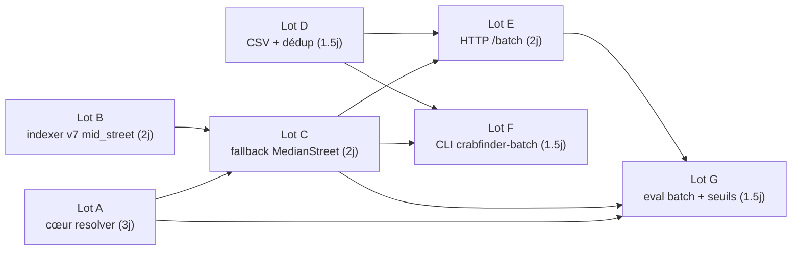

# v1 batch: plan d'action

> **Statut (2026-10-16)** : plan d'exécution d'origine, conservé pour l'historique. Les lots A à G sont livrés (v2), avec ces écarts de chemins par rapport au texte : la logique est dans une bibliothèque (`crates/crabfinder-service/src/lib.rs`, `main.rs` est un wrapper mince) ; les modules sont `resolver.rs`, `query_builder.rs`, `focus.rs`, `hydrate.rs`, `mid_street.rs`, `batch/{io,dedup,http,mod}.rs` ; les handlers HTTP sont dans `http/` ; le CLI est `crates/crabfinder-batch` ; le mode eval s'appelle `--batch-mode` (pas `--mode batch`) et vit dans `crates/crabfinder-eval/src/batch_mode.rs`. Le schéma d'index est aujourd'hui en **v12** (`meta.rs`), les « v6 / v7 » ci-dessous sont l'état d'alors. Tantivy est en 0.26, `rstar` en 0.13. Le multi-process read (§4.5) est validé : CLI et service partagent un index. Les seuils de confiance vivent côté eval (`crabfinder-eval/data/confidence-thresholds-v1.json`) ; `street_match_score` sort en BM25 brut.
>
> Pas encore fait : réponse `/batch/geocode` réellement streamée et délai batch corrigé (Phase 11.6), jobs batch asynchrones, Docker compose et clés d'API (Phase 11.7). L'autocomplete (Phase 11.5) est en cours, pas livré.

Plan d'exécution concret pour la v1 batch décrite dans [`design-batch-geocoding.md`](./design-batch-geocoding.md) §5. Lecture des deux documents source supposée acquise. Toutes les décisions tranchées en §1–§4 du design sont *non négociables* dans ce plan ; les éléments restés ouverts sont rassemblés en §4.

Conventions : chemins absolus relatifs à la racine du workspace (`crates/...`). « Effort » = j-h pour un dev seul familier avec Rust mais nouveau sur le projet, après avoir lu les deux docs.

---

## 1. Lots de travail

### Lot A: Cœur `resolver` pur, sans régression `/geocode`

**Objectif** : extraire de `crabfinder-service/src/main.rs` les briques pures dont batch et recherche ont besoin, et poser la signature `resolve()` du design §1.1, sans toucher au comportement externe de `/geocode`.

**Scope** :
- NEW `crates/crabfinder-service/src/query_builder.rs`, déplacer `build_strict_query`, `build_fuzzy_query`, `FilterParams`, `searchable_field`, `analyze` (lignes ~430–1158 du `main.rs` actuel).
- NEW `crates/crabfinder-service/src/focus.rs`, extraire l'application du décay `focus_point` (lignes ~640–674 actuelles) en `fn apply_focus_decay(hits: &mut [RawHit], focus: (f64, f64), schema, docs)`.
- NEW `crates/crabfinder-service/src/hydrate.rs`, déplacer `hydrate()` (ligne 1160) et le rendre indépendant du type `Feature` HTTP (renvoyer un struct intermédiaire `HydratedHit { address: Address, lat, lon, score, match_type, building_group_id, payload }`).
- NEW `crates/crabfinder-service/src/resolver.rs`, types `AddressQuery`, `ResolvedAddress`, `Confidence`, `FallbackReason`, `ResolverContext`, et `pub fn resolve(query, ctx) -> ResolvedAddress`. À ce stade le résolveur **n'implémente que les confidences `Exact`, `FuzzyStreet`, `NotFound`** (pas encore de mid_street ; c'est le Lot C).
- MODIFY `crates/crabfinder-service/src/main.rs`, `geocode()` consomme `query_builder::build_strict_query`, `query_builder::build_fuzzy_query`, `focus::apply_focus_decay`, `hydrate::hydrate`. Pipeline final inchangé fonctionnellement.

**Done** :
1. `cargo test -p crabfinder-service` vert (tests existants ligne ~1201+).
2. `crabfinder-eval --eval-set <existing>` produit un report dont les métriques `recall@1/3/10` et `top_match_type` distribution sont **identiques bit-à-bit** à la baseline pré-refactor. Procédure : capture du JSON report sur `main` avant Lot A, comparaison `jq` après.
3. Le binaire `crabfinder-service` démarre sur l'index v6 existant et `/health` renvoie le même `index_docs`.

**Dépendances** : aucune (point de départ).

**Effort** : **3 j-h**. La grosse partie est de prouver la non-régression, pas le mouvement de code.

---

### Lot B: Schéma index v7 : numéro médian par `(street_id, postal_code)`

**Objectif** : précomputer et persister les coordonnées du numéro médian par couple `(street_id, postal_code)`, pour lookup O(1) au runtime.

**Scope** :
- MODIFY `crates/crabfinder-indexer/src/meta.rs`, `SCHEMA_VERSION` 6 → 7, ajouter l'entrée changelog (« v7: side-table `mid-street-v1.bin` produite par l'indexer ; lookup `(street_id, postal_code) → (lat, lon)` pour le fallback batch `MedianStreet` »). Le sidecar `.crab-meta.json` continue de fonctionner ; `check_sidecar` rejette les v6.
- NEW `crates/crabfinder-indexer/src/mid_street.rs`, module pur :
  - `pub struct MidStreetBuilder { groups: HashMap<(StreetId, String), Vec<(u32, f64, f64)>> }` (clé `(street_id, postal_code)`, valeur `[(num_int, lat, lon)]`).
  - `pub fn record(&mut self, addr: &Address)` appelé par chaque pass-2 emit. Conserve uniquement les numéros parsables en `u32` (suffixes alphabétiques droppés pour le calcul de médiane).
  - `pub fn finish(self, out: &Path) -> Result<()>`, pour chaque groupe, sélectionne le numéro à l'ordre statistique médian (PhacochR §2.1, `type=3 = discret, arrondi bas` cf. `comparison-phacochr.md` §2.1) et sérialise en binaire compact : `[u32 street_oid_len, bytes, u8 postal_len, bytes, f64 lat, f64 lon]` répété N fois, précédé d'un header `magic=CRAB-MID7 + n_entries: u64`.
- MODIFY `crates/crabfinder-indexer/src/main.rs`, instancier `MidStreetBuilder` avant la boucle Pass 2, appeler `.record()` dans la closure `|addr| { ... }` (autour de la ligne 155), `.finish(output.join("mid-street-v1.bin"))` après commit.

**Done** :
1. `cargo test -p crabfinder-indexer` vert (test unitaire `mid_street::tests::median_picks_middle_rank` à ajouter : feed une liste `[2, 4, 6, 8, 10]` → attendre `6`, lat/lon associés).
2. Re-indexation Brussels seul (`--region brussels`) produit `mid-street-v1.bin` non vide.
3. Re-indexation full Belgium (~2.3 min selon README) produit un fichier dont `wc -c` correspond à `n_entries * (~30 octets moyens)` ; `n_entries` ≈ nombre de couples `(street, cp)` distincts (sanity check : ~300k–500k).
4. Le sidecar `.crab-meta.json` porte `schema_version: 7`.

**Dépendances** : aucune (peut être fait en parallèle avec A).

**Effort** : **2 j-h**.

---

### Lot C: Fallback `Confidence::MedianStreet` dans le résolveur

**Objectif** : brancher le lookup mid_street dans `resolve()` ; émettre `Confidence::MedianStreet` quand la rue matche mais pas le numéro.

**Scope** :
- NEW `crates/crabfinder-service/src/mid_street.rs`, chargement mmap du fichier binaire produit par Lot B :
  - `pub struct MidStreetIndex { map: HashMap<(String, String), (f64, f64)> }` (clé string-string pour éviter la dépendance circulaire au type `StreetId` ; valeur `(lat, lon)`).
  - `pub fn load(path: &Path) -> Result<Self>` ; renvoie `Self::empty()` si fichier absent (compat avec index v7 vides).
  - `pub fn lookup(&self, street_id: &str, postal_code: &str) -> Option<(f64, f64)>`.
- MODIFY `crates/crabfinder-service/src/resolver.rs`, dans `resolve()` :
  1. Tenter strict avec house_number → si hit, `Exact` (delta=0).
  2. Si zéro hit ET `query.house_number.is_some()` → relancer strict **sans** le filtre `house_number` (mais avec rue + cp). Si hit → on a la rue, retourner `MedianStreet` en utilisant `mid_street_lookup` sur `(street_id_du_top_hit, postal_code)`. `fallback_reason = HouseNumberMissing` ou `HouseNumberOutOfRange`. Coordonnées = celles du lookup, **pas celles du top_hit**.
  3. Si `query.house_number.is_none()` et un hit rue est trouvé → `MedianStreet` directement, `fallback_reason = HouseNumberMissing`.
  4. Si toujours rien → fallback fuzzy (existant), `Confidence::FuzzyStreet`, lookup mid_street si pas de numéro exact post-fuzzy.
  5. Si rien partout → `NotFound`.
- MODIFY `crates/crabfinder-service/src/main.rs`, charger `MidStreetIndex` au démarrage (à côté du chargement abbrev, ligne ~167), ajouter `Arc<MidStreetIndex>` dans `AppState` mais **non utilisé par `/geocode`** (le résolveur n'est consommé que par le batch en v1, cf. design §1.3 option A).

**Done** :
1. Test unitaire `resolver::tests::median_fallback_when_number_missing` : fixture Avenue Louise avec mid_street → `MedianStreet` retourné, lat/lon = mid, delta = None.
2. Test unitaire `resolver::tests::median_fallback_when_number_out_of_range` : Avenue Louise n°99999 absent → `MedianStreet`, `fallback_reason = HouseNumberOutOfRange`.
3. Le démarrage du service charge le fichier mid_street en < 500 ms, taille mémoire < 50 MB (estimation : 400k entrées × ~120 octets en RAM HashMap).

**Dépendances** : Lot A (signature résolveur) + Lot B (fichier produit).

**Effort** : **2 j-h**.

---

### Lot D: Lecture/écriture CSV + dédup intra-batch

**Objectif** : I/O CSV mince et dédup par triplet `(street_lower, house_number, postal_code)` selon design §3.5.

**Scope** :
- NEW `crates/crabfinder-service/src/batch/mod.rs` (module batch dans le service crate).
- NEW `crates/crabfinder-service/src/batch/io.rs` :
  - `pub struct InputRow { id: String, street: String, house_number: Option<String>, postal_code: Option<String> }` (serde Deserialize, `#[serde(rename = ...)]` insensible à la casse du header).
  - `pub fn read_rows<R: Read>(r: R, delim: u8) -> impl Iterator<Item = Result<InputRow, BatchError>>` (auto-détection `,` / `;` sur la première ligne, design §2.1 supporte les deux).
  - `pub struct OutputRow { /* champs §3.2 */ }` (serde Serialize, ordre des colonnes figé).
  - `pub fn write_rows<W: Write>(w: W) -> impl FnMut(OutputRow) -> Result<(), BatchError>` ; flush ligne à ligne (streaming, design §4.4).
- NEW `crates/crabfinder-service/src/batch/dedup.rs` :
  - `pub fn dedup_then_resolve(rows, ctx, n_workers) -> impl Iterator<Item = OutputRow>` ; index `HashMap<(String, Option<String>, Option<String>), ResolvedAddress>` calculé via `rayon::par_iter` sur les triplets uniques, puis propagé sur les rows d'entrée. Ne casse pas le 1-in-1-out.
- MODIFY `crates/crabfinder-service/Cargo.toml`, ajouter `csv = "1.3"`.

**Done** :
1. Test unitaire `batch::io::tests::reads_comma_and_semicolon` (deux fixtures inline).
2. Test unitaire `batch::dedup::tests::preserves_input_order_and_count` : 5 lignes avec 2 doublons → 5 lignes en sortie, dédup interne appelle `resolve()` 3 fois.

**Dépendances** : aucune côté code (peut tourner sans le résolveur réel via un trait `Resolve` injectable pour les tests). Intégration au pipeline réel = Lots E/F.

**Effort** : **1.5 j-h**.

---

### Lot E: Endpoint HTTP `POST /batch/geocode` streamé

**Objectif** : façade HTTP §4.1, multipart pour fichier, JSON pour liste inline, réponse `text/csv` streamée.

**Scope** :
- NEW `crates/crabfinder-service/src/batch/http.rs` :
  - `pub async fn batch_geocode(State, multipart_or_json) -> Response`.
  - Multipart : champ `file` (bytes), champ `options` (JSON string parsé en `BatchOptions { mid_street_fallback: bool, format: "csv" }`).
  - JSON : `{ addresses: Vec<InputRow>, options: BatchOptions }`.
  - Réponse : `axum::body::Body::from_stream(...)`. Streaming `OutputRow` → CSV serializé → bytes, via un `tokio::sync::mpsc` channel et `rayon::spawn` pour le worker pool de résolution (cf. design §4.4 pattern `buffered_unordered`).
- MODIFY `crates/crabfinder-service/src/main.rs`, `.route("/batch/geocode", post(batch::http::batch_geocode))`.
- MODIFY `crates/crabfinder-service/Cargo.toml`, ajouter `axum = { workspace = true, features = ["multipart"] }`, `futures = "0.3"`.

**Done** :
1. `curl -X POST -F file=@fixtures/batch-100.csv http://127.0.0.1:8080/batch/geocode -o out.csv` produit 100 lignes (+ 1 header).
2. Test d'intégration `batch::http::tests::streams_first_byte_under_2s_for_10k` : fixture 10k lignes, `time-to-first-byte` < 2 s.
3. `confidence` distribution sur le fixture : ≥ 60% `exact`, ≤ 5% `not_found`.

**Dépendances** : A + C + D.

**Effort** : **2 j-h**.

---

### Lot F: Binaire `crabfinder-batch` (CLI)

**Objectif** : façade CLI §4.2, ouvre l'index en lecture, parcourt CSV → CSV.

**Scope** :
- NEW `crates/crabfinder-batch/Cargo.toml` (nouveau crate workspace member). Dépendances : `crabfinder-core`, `crabfinder-indexer` (pour `CrabSchema`, `check_sidecar`), `crabfinder-service = { path = "../crabfinder-service" }` (exposer les modules `batch`, `resolver`, `mid_street`, `abbreviation`, `addr_count` via `pub mod` ou `pub use`). Workspace : ajouter dans `Cargo.toml` racine, `members += "crates/crabfinder-batch"`.
- NEW `crates/crabfinder-batch/src/main.rs` : `clap` parser (flags `--index`, `--abbreviation-dict`, `--input`, `--output`, `--format csv`, `--mid-street/--no-mid-street`, `--parallel N` défaut `num_cpus::get()`).
  - Ouvre l'index : `Index::open_in_dir`, `register_tokenizers`, build `Searcher` + `AddressCountIndex` + `AbbreviationMap` + `MidStreetIndex`.
  - Stream depuis `stdin` ou fichier ; pool rayon ; écrit stdout ou fichier.
- MODIFY `crabfinder-service/src/main.rs`, promouvoir en `pub` les modules `batch`, `resolver`, `mid_street`, `abbreviation`, `addr_count`, `query_builder`, `hydrate`, `focus`, ou les déplacer dans `crabfinder-service/src/lib.rs` (recommandé : créer `lib.rs` + faire pointer `main.rs` dessus). Le binaire HTTP reste `[[bin]] name = "crabfinder-service"`.

**Done** :
1. `cargo run --release -p crabfinder-batch -- --index ./index-belgium --input fixtures/batch-100.csv --output /tmp/out.csv` produit le même `/tmp/out.csv` que l'endpoint HTTP avec un `diff` vide.
2. Le binaire tourne sans démarrer `crabfinder-service` (smoke test : couper le service, relancer la CLI).
3. Throughput : 10k lignes / `num_cpus * 1.5k qps` ≈ quelques secondes sur laptop dev.

**Dépendances** : A + C + D. Peut se développer en parallèle de E une fois D fait.

**Effort** : **1.5 j-h**.

---

### Lot G: Eval batch + non-régression `/geocode`

**Objectif** : calibration des seuils `street_match_score` bucketisé (§3.3 option C) et garde-fou de régression.

**Scope** :
- MODIFY `crates/crabfinder-eval/src/cli.rs`, nouveau flag `--mode batch`, prend un CSV d'entrée (réutilise un échantillon de l'eval set synthétique reformaté en colonnes propres) et appelle le résolveur en process (pas HTTP).
- NEW `crates/crabfinder-eval/src/batch_mode.rs` :
  - Charge l'eval set existant, le convertit en `Vec<InputRow>` (street_tokens recollés, house_number et postal_code mis dans leurs colonnes).
  - Tourne `resolve()` en boucle (via dep crate `crabfinder-service`).
  - Calcule : distribution `confidence`, taux `not_found`, distribution `street_match_score` brut → propose 4 seuils empiriques quartiles → écrit dans `crates/crabfinder-eval/data/confidence-thresholds-v1.json`.
- NEW `crates/crabfinder-service/data/confidence-thresholds-v1.json` (config chargée par le résolveur ; valeurs intermédiaires en attendant Lot G).

**Done** :
1. `crabfinder-eval --mode batch --eval-set ... --output batch-report.json` produit un report avec la distribution.
2. Comparaison de la distribution `confidence` entre deux runs successifs sur le même index → 0 drift (déterminisme).
3. Bonus : taux `not_found` < 5% sur l'eval set Tier A.

**Dépendances** : A + C + D + E (ou F). Peut commencer dès que A est mergé pour les bouts non-batch.

**Effort** : **1.5 j-h**.

---

**Total** : 3 + 2 + 2 + 1.5 + 2 + 1.5 + 1.5 ≈ **13.5 j-h**, dans la cible 10–14 j-h du design §5.

---

## 2. Ordonnancement

Chemin critique : **A → C → E → G**, ~9 j-h. Lot B se déroule en parallèle de A. Lot D en parallèle de A + B + C (n'exige que des traits, pas le résolveur réel). Lot F peut être pris par un second dev en parallèle de E. Lot G commence dès que C est mergé.

Avec un seul dev, ordre séquentiel naturel : **A, B, D, C, E, F, G**.

---

## 3. Risques techniques et mitigation

### 3.1 Refactor `/geocode` sans régression (Lot A)

**Risque** : déplacer `build_strict_query` / `build_fuzzy_query` / `hydrate` casse un cas edge (focus_point décay appliqué dans le mauvais ordre, dedup post-hydrate qui voit un score différent, etc.). Les tests unitaires couvrent le bon cas, pas l'arithmétique flottante.

**Mitigation** :
1. **Baseline JSON figée**. Avant Lot A : `crabfinder-eval --eval-set tier-a.json --service http://localhost:8080 --output baseline-pre-refactor.json`. Après Lot A : refaire le run, `jq -S` les deux, `diff`. Tout delta `score` > 1e-5 est un bug à investiguer.
2. **Snapshot des features**. Ajouter un test `service::tests::geocode_returns_stable_features_for_known_queries` qui appelle `geocode()` directement sur 5 fixtures et compare l'output sérialisé via `insta::assert_json_snapshot!`. `insta` est déjà dans le workspace (`Cargo.toml:66`).
3. **Bench p99**. `criterion` est dans le workspace. Ajouter un bench `bench_geocode_p99` qui mesure `geocode()` sur 100 requêtes, baseline pré/post. Tolérance : ±10%.
4. **Pas de changement sémantique sous prétexte de refactor**. Si on découvre un bug pendant le déplacement, on l'isole dans un commit séparé post-Lot A.

### 3.2 Migration index v6 → v7 (Lot B)

**Risque** : la `SCHEMA_VERSION` bump force un rebuild complet des 6.8M docs (~2.3 min selon README, mais c'est sur du matériel donné). Les utilisateurs externes qui ont buildé l'index sur un autre dump BeSt doivent rebuilder. Risque d'oubli → service refuse de démarrer (cf. `meta::check_sidecar`).

**Mitigation** :
1. **Le sidecar fait déjà le travail**, `check_sidecar` produit un message d'erreur qui *inclut la commande de rebuild* (`crates/crabfinder-indexer/src/meta.rs:46-53`). C'est conçu pour ça. Ne rien désactiver.
2. **Mid_street généré côté = optionnel pour les v7 anciens**. `MidStreetIndex::load` doit retourner `Self::empty()` si le fichier `mid-street-v1.bin` est absent (cas : utilisateur a re-buildé l'index v7 avec une version `crabfinder-indexer` antérieure au Lot B). Logger un warning au démarrage, désactiver `Confidence::MedianStreet` proprement.
3. **CI rebuild**. Ajouter une étape CI qui re-build un mini-index (`--region brussels --limit 1000`) et vérifie que `mid-street-v1.bin` est produit. Évite la régression silencieuse.
4. **Pas de rolling upgrade**. La v7 n'est pas backward-compatible et c'est OK : crabfinder n'a pas de mode HA. Un downtime de 2–3 min pour rebuild est acceptable.

### 3.3 Thread-safety du résolveur sous parallélisme batch

**Risque** : `resolve()` est appelé depuis un pool rayon (CLI) ou un worker tokio (HTTP). Chaque appel partage `ResolverContext { searcher, schema, abbrev, addr_counts, mid_street_lookup }`. Si l'un des accès cache un `RefCell`, un `Mutex`, ou (pire) une mutation interne, le batch sérialise sur ce point chaud.

**Mitigation** :
1. **Tout est `Arc<T>` immutable**. `Searcher` Tantivy est `Sync` (par construction du `IndexReader`). `AbbreviationMap`, `AddressCountIndex`, `MidStreetIndex` : leurs accesseurs publics doivent prendre `&self`, pas `&mut self`. **Audit explicite à l'issue du Lot C** : `grep -n "&mut self" crates/crabfinder-service/src/{resolver,abbreviation,addr_count,mid_street}.rs` doit ne rien sortir hors `Builder` / `Loader`.
2. **Test de charge dédié** dans le Lot G : run le CLI avec `--parallel 16` sur 10k lignes ; vérifier que CPU > 800% sur une machine 16 cœurs (sinon il y a un point de contention). `cargo flamegraph` si besoin.
3. **Pas de cache global mutable** dans `resolve()`. Même un `LruCache` partagé devient un goulot d'étranglement (`Mutex<LruCache>`). Si une optim cache est tentante, elle se met au-dessus, pas dedans.

---

## 4. Points non tranchés par les deux documents

### 4.1 Persistance du mid_street : champ FAST per-doc ou side-table binaire ?

Design §5.5 propose les deux options sans trancher.

**Options** :
- (a) FAST f64 `street_mid_lat` + `street_mid_lon` répliqués sur chaque doc (6.8M × 16 B = 110 MB index). Lookup intégré au pipeline Tantivy.
- (b) Side-table `mid-street-v1.bin` mappée en RAM (estimé ~50 MB ; ~400k entrées × ~120 B HashMap). Lookup hors Tantivy.

**Recommandation** : **(b)**. Trois raisons : (i) Le mid_street est conceptuellement une donnée *par rue×CP*, pas *par adresse*, la répliquer 6.8M fois est sémantiquement faux et bloque les futures optimisations (ex : on voudra mid_street au niveau secteur statistique en post-v1, cf. PhacochR §2.6). (ii) Plus petit sur disque, donc rebuild plus rapide. (iii) Découplage clair : on peut régénérer la side-table sans réindexer Tantivy si on change l'algorithme du choix médian.

Ce plan **suppose l'option (b)** dans le Lot B. Si on change d'avis, c'est `MidStreetBuilder` qui change, pas le contrat du résolveur.

### 4.2 Emplacement du binaire CLI : sous-bin de `crabfinder-service` ou crate dédié ?

Design §4.2 dit « binaire `crabfinder-batch` » sans préciser la structure cargo.

**Options** :
- (a) `[[bin]]` supplémentaire dans `crabfinder-service` (`src/bin/crabfinder-batch.rs`). Pas de nouveau crate, partage automatique des modules.
- (b) Nouveau crate `crabfinder-batch` dans le workspace, dépend de `crabfinder-service` comme lib.

**Recommandation** : **(b)**. Forçe la promotion des modules batch en API stable (via `crabfinder-service/src/lib.rs`), évite que le binaire batch traîne des deps HTTP (axum, tower) à la compilation. Coût : un `Cargo.toml` de plus. Le Lot F suppose (b).

### 4.3 Comportement `mid_street` quand `house_number` est *fourni* mais aucun match rue strict

Design §3.4 dit : « la rue matche mais ni le numéro exact ni un voisin n'est trouvé » → MedianStreet. Mais quid de : « pas de match rue en strict, fuzzy trouve la rue, et la rue trouvée n'a pas le numéro » ? Faut-il chaîner `FuzzyStreet` + `MedianStreet` ?

**Options** :
- (a) Émettre `Confidence::FuzzyStreet`, lat/lon = top hit fuzzy, `house_number_delta` rempli si numéro voisin sinon `None`.
- (b) Émettre une combinaison genre `FuzzyMedianStreet`, ou une notion `Confidence::FuzzyStreet` + `fallback_reason = HouseNumberMissing` cumulé.
- (c) Émettre `MedianStreet` avec lat/lon = mid de la rue fuzzy-trouvée, perdre l'info « la rue elle-même est fuzzy ».

**Recommandation** : **(b)** modifié, garder `Confidence` mono-valeur (`FuzzyStreet`) mais émettre **lat/lon = mid_street** quand il n'y a pas de numéro exact et populer `fallback_reason = HouseNumberMissing`. Sémantique : « rue trouvée approximativement, point représentatif = centroïde rue ». Le destinataire batch peut filtrer `confidence == FuzzyStreet AND fallback_reason == HouseNumberMissing` pour les cas doublement dégradés. Pas de nouvelle valeur d'enum à introduire.

### 4.4 Seuils de bucketisation `street_match_score` (v1)

Design §3.3 option C tranche pour 4 buckets, mais laisse les seuils à calibrer.

**Options** :
- (a) Calibrer dès le Lot G (mais alors l'eval batch dépend du résolveur opérationnel, circular).
- (b) Sortir le `score` BM25 brut en v1 et bucketiser en v1.1 quand on a des retours utilisateurs.
- (c) Bucketiser dès la v1 avec des seuils provisoires (quartiles de l'eval Tier A actuel) et publier un changelog quand on les ajuste.

**Recommandation** : **(c)**. C'est ce que dit design §3.3 in fine (« seuils ... une donnée externe (config), pas une décision figée »). Stocker dans `data/confidence-thresholds-v1.json`, charger au démarrage. Le Lot G calibre la première version ; les versions ultérieures sont des bumps du fichier, pas du schéma.

### 4.5 Multi-process read Tantivy : CLI tournant à côté du service ?

Design §4.2 : « Tantivy supporte la lecture multi-process sur le même index, ce devrait être OK, à vérifier sur la version en usage ».

**Options** :
- (a) Vérifier expérimentalement et autoriser.
- (b) Documenter que CLI exige le service arrêté ; ajouter un check au démarrage CLI (lock file ?).
- (c) Recommander de copier l'index en lecture pour la CLI (coût disque, complexité).

**Recommandation** : **(a)**. Test rapide en Lot F : démarrer le service sur port 8080, lancer `crabfinder-batch --input ...` à côté, vérifier que les deux retournent les mêmes résultats sur les mêmes 10 requêtes. Tantivy 0.26 utilise mmap en lecture (`MmapDirectory`), c'est censé fonctionner. Si ça pète, retomber sur (b) avec un message d'erreur clair. **Pas de copie de l'index**, on a 2 GB sur disque, ne pas dupliquer.

### 4.6 Format JSON vs multipart pour `POST /batch/geocode`

Design §4.1 propose les deux ; sans trancher pour la v1.

**Options** :
- (a) Multipart uniquement (fichier CSV uploadé).
- (b) JSON uniquement (`{ addresses: [...] }`).
- (c) Les deux, auto-détectés via `Content-Type`.

**Recommandation** : **(c)**, l'effort marginal est ~30 min, et les deux cas d'usage sont légitimes (un script python passe naturellement par JSON pour 100 lignes ; un export Excel-converti passe par multipart pour 100k lignes). Limiter le JSON à 10k `addresses` (refuser au-delà avec un 413 → utiliser multipart).

---

## 5. Feuille de route séquencée (un dev seul)

| Sprint | Durée | Contenu | Livrable |
|---|---|---|---|
| **Sprint 1** | 3 j-h | Lot A (refactor cœur, sans régression) | `cargo test` vert + eval JSON identique à la baseline |
| **Sprint 2** | 3.5 j-h | Lots B + D en parallèle conceptuel (B = matin, D = après-midi) | `mid-street-v1.bin` produit ; module batch::io testé |
| **Sprint 3** | 2 j-h | Lot C (fallback MedianStreet branché au résolveur) | Test résolveur unitaire vert, démarrage service charge mid_street |
| **Sprint 4** | 3.5 j-h | Lots E + F (HTTP + CLI sur le même cœur) | `curl POST /batch/geocode` + `crabfinder-batch` produisent CSVs identiques |
| **Sprint 5** | 1.5 j-h | Lot G (eval batch + seuils confidence) | `confidence-thresholds-v1.json` commité + report eval batch publié |

Total : **13.5 j-h** sur 5 sprints courts (≈ 3 semaines à 1 j-h/jour, ou 2 semaines à plein temps).

Critères de fin de v1 (recette) :
- `cargo test --workspace` vert.
- Eval `/geocode` non régressé (diff bit-à-bit sur le report Tier A).
- Eval batch produit un report avec `not_found < 5%` et distribution `confidence` documentée.
- README mis à jour avec section « Batch geocoding » documentant les deux façades.
- Sidecar v7 documenté, message d'erreur de rebuild testé.
